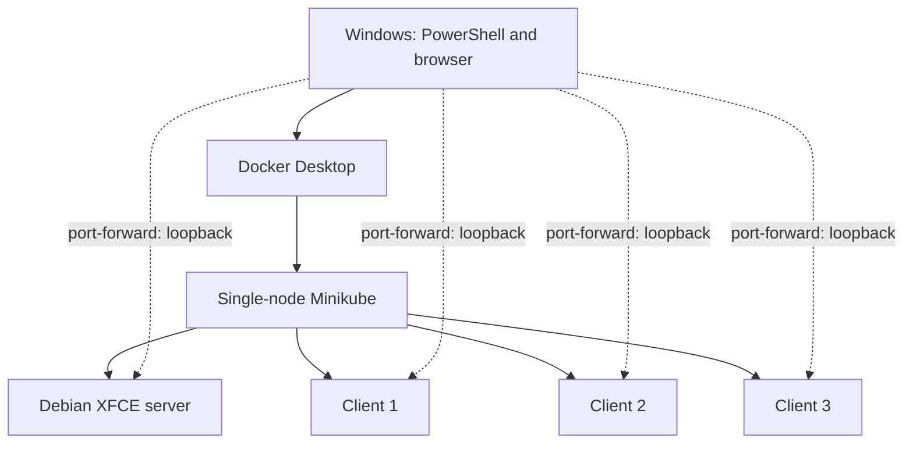

# Debian Network Lab

[](https://github.com/melekhovv/debian-lab-k8s/actions/workflows/validate.yml)

**Linux networking · Kubernetes · PowerShell · Container state recovery**

[Русский](README.md)

[Seven-minute demo](docs/demo.md) · [Engineering decisions](docs/decisions.md) · [Evidence](docs/evidence/README.md) (detailed guides in Russian)

A home lab for Linux administration, IPv4 routing and container operations. Windows and Docker Desktop host a single-node Minikube cluster with one Debian XFCE server and three clients, each accessible through a browser desktop.

The main engineering features are routing between three lab subnets through the server and a custom container-state backup mechanism. The repository demonstrates implementation; completed exercises require separate evidence.

## Status and evidence

Documentation is based on a static review of commit `b8a8e257080ed0c731942157e16c15e69892f275` performed on November 14, 2026. The lab was not started during documentation work.

**Runtime checked on November 14:** four Pods, services, all six client routing directions with packets entering/leaving the server, three responding Zabbix agents and recent metrics in the database. [Protocol and evidence](docs/evidence/2026-11-14-runtime.md). Starting the existing environment resolved the initial Docker unavailability. Independent disaster recovery and alerting remain untested.

| Area | Verified in source | Still requires runtime evidence |
|---|---|---|
| Kubernetes | Four Pods running on recorded versions; manifests and resources in Git | Other versions and load testing |
| Routing | Six TCP paths, forwarding counters and server ingress/egress with TTL 63 → 62 | Failure cases and bypass resistance after configuration changes |
| Linux services | Running MariaDB, Apache and Zabbix services; frontend HTTP 200 | Reproducible installation from Git |
| Zabbix | Three agents return agent.ping = 1; recent client metrics in the database | Configuration export, trigger and notification tests |
| Backup/recovery | Normal restore completed; four Windows archives readable with recorded SHA-256 | Independent Windows-archive restore and database verification |

This is a learning environment, not a production cluster. Desktops are containers sharing the node kernel, not independent VMs. Repository content does not establish commercial experience or completed operational exercises.

## Skills demonstrated by the implementation

- Linux networking: IPv4, routes, forwarding, proxy ARP, policy routing and conntrack troubleshooting.
- Kubernetes: Deployments, Services, namespaces, resource allocation and Pod diagnostics.
- PowerShell: shared configuration, tool discovery and supervised port forwarding.
- Linux operations: startup of installed services and hostname persistence helpers.
- State management: overlayfs, rsync, archiving and recovery limitations.

Case studies (Russian): [routing](docs/cases/routing.md), [Linux services](docs/cases/linux-services.md), [Zabbix monitoring](docs/cases/zabbix-monitoring.md), [backup/recovery](docs/cases/backup-recovery.md). Runtime results are linked in the [protocol](docs/evidence/2026-11-14-runtime.md); each case states its remaining limitations.

## Architecture



Minikube arrows show placement, not the lab packet path. See [architecture](docs/architecture.md) and [network topology](docs/network-topology.md) (Russian).

| Desktop | Default browser URL | Additional lab addresses |
|---|---|---|
| Server | http://localhost:3000 | 192.168.2.254, 192.168.3.254, 192.168.4.254 |
| Client 1 | http://localhost:3001 | 192.168.2.1/24 |
| Client 2 | http://localhost:3002 | 192.168.3.1/24 |
| Client 3 | http://localhost:3003 | 192.168.4.1/24 |

http://localhost:3000/zabbix requires a separately installed and configured Zabbix frontend, Apache and database. Current scripts do not install these packages.

## Getting started

Requirements: Windows, PowerShell, Docker Desktop with Linux containers, `minikube` and `kubectl`. New nodes default to 4 CPUs and 6144 MB RAM. Allow additional memory for Docker Desktop and Windows. Versions from the observed session are listed in the [protocol](docs/evidence/2026-11-14-runtime.md); load-related resource usage has not been measured.

Use a dedicated lab environment. Startup changes node routing/firewall rules and directly targets a Docker container named `minikube`. Read [installation](docs/installation.md) and [security considerations](docs/security-considerations.md) before running it.

```powershell
.\start-debian.ps1 -NoBrowser
```

Alternatively, open `start-debian.bat`. On first run, `lab.config.ps1` is copied from the [example](lab.config.example.ps1). Preserve existing local settings. Keep the startup window open for port forwarding. Manifests are applied on every start; Pod template changes can recreate containers and discard unsaved state.

## Saving and stopping

The active manifests have no persistent volumes. Unsaved writable-layer changes can be lost when a container is recreated.

```powershell
.\save-state.ps1
.\stop-debian.ps1
```

The stop script also offers to save state, then stop or pause Minikube. Saving temporarily stops detected database services. Check the summary and Windows archives; a success message is not a recovery test. See [backup/recovery](docs/cases/backup-recovery.md).

## Security boundaries

The desktops are intended for local learning without configured desktop authentication. The server is privileged; clients have `NET_ADMIN`. Keep `$BindAddress = "127.0.0.1"`. A privileged server can affect the Minikube node. ClusterIP does not prevent access from within the cluster. Backups may contain passwords, keys and databases and are excluded from Git.

## Repository and documentation

| Path | Purpose |
|---|---|
| `start-debian.*`, `save-state.*`, `stop-debian.*` | Start, save and stop |
| `lab-common.ps1`, `lab.config.example.ps1` | Shared helpers, topology and configuration template |
| `k8s/` | Active Kubernetes manifests |
| `legacy/` | Historical Docker/VNC and Hyper-V implementation; unused by the main launcher |
| `docs/` | Architecture, operations, case studies and evidence register (Russian) |

- [Installation and configuration](docs/installation.md)
- [Troubleshooting](docs/troubleshooting.md)
- [Security considerations](docs/security-considerations.md)
- [Evidence and acceptance criteria](docs/evidence/README.md)
- [Audit and roadmap](docs/audit-and-roadmap.md)

## Automated validation

GitHub Actions checks active manifest contracts, local links and PowerShell syntax without executing the lab scripts. Six regression tests cover the current configuration and detection of broken selectors, target ports, unpinned images, external exposure and missing resource limits. These are offline checks, not application availability tests. Local commands and an observation collector are documented in the [demo guide](docs/demo.md).

Next: independent recovery testing on a separate copy and controlled alerting validation. Image, network, privilege and storage changes, as well as recovery drills, require separate agreement and a rollback plan.
