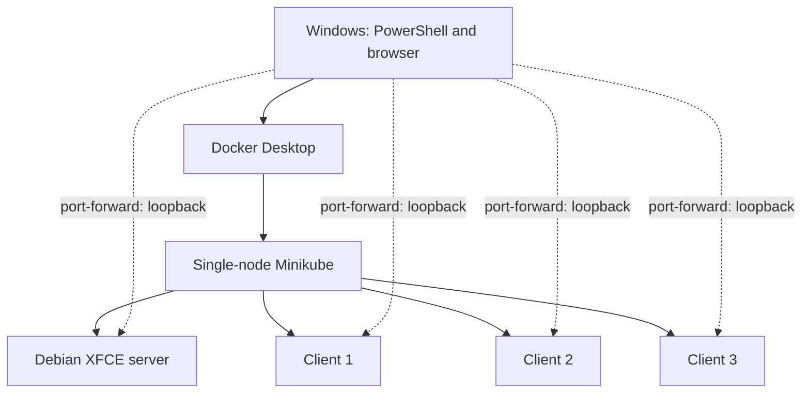

# Debian Network Lab — System Administration Portfolio

[Русский](README.md)

A home lab for Linux administration, IPv4 routing and container operations. Windows and Docker Desktop host a single-node Minikube cluster with one Debian XFCE server and three clients, each accessible through a browser desktop.

The main engineering features are routing between three lab subnets through the server and a custom container-state backup mechanism. The repository demonstrates implementation; completed exercises require separate evidence.

## Status and evidence

Documentation is based on a static review of commit `b8a8e257080ed0c731942157e16c15e69892f275` performed on November 14, 2026. The lab was not started during documentation work.

A subsequent [availability check](docs/evidence/2026-11-14-preflight.md) on November 14 found Docker Engine and the Kubernetes API unavailable, preventing runtime checks. PowerShell and YAML syntax checks passed without executing the lab scripts.

| Area | Verified in source | Still requires runtime evidence |
|---|---|---|
| Kubernetes | Namespace, four Deployments and ClusterIP Services, requests/limits, digest-pinned image | Deployment on recorded tool versions |
| Routing | IPv4 addresses, proxy ARP, policy routing, NOTRACK and a client1 → client2 self-test | All six directed client paths and actual packet traversal |
| Linux services | Conditional startup of installed MariaDB, Apache and Zabbix services | Package installation, application configuration and health |
| Zabbix | Service names and `/zabbix` reverse proxy | Metrics, hosts/templates, triggers and an alert; operational monitoring is unverified |
| Backup/recovery | Writable-layer copy, whiteout handling, archive export/import | Integrity checks and successful file/database recovery |

This is a learning environment, not a production cluster. Desktops are containers sharing the node kernel, not independent VMs. Repository content does not establish commercial experience or completed operational exercises.

## Skills demonstrated by the implementation

- Linux networking: IPv4, routes, forwarding, proxy ARP, policy routing and conntrack troubleshooting.
- Kubernetes: Deployments, Services, namespaces, resource allocation and Pod diagnostics.
- PowerShell: shared configuration, tool discovery and supervised port forwarding.
- Linux operations: startup of installed services and hostname persistence helpers.
- State management: overlayfs, rsync, archiving and recovery limitations.

Case studies (Russian): [routing](docs/cases/routing.md), [Linux services](docs/cases/linux-services.md), [Zabbix monitoring](docs/cases/zabbix-monitoring.md), [backup/recovery](docs/cases/backup-recovery.md). All currently have source-level evidence only; runtime results have not been supplied.

## Architecture



Minikube arrows show placement, not the lab packet path. See [architecture](docs/architecture.md) and [network topology](docs/network-topology.md) (Russian).

| Desktop | Default browser URL | Additional lab addresses |
|---|---|---|
| Server | http://localhost:3000 | 192.168.2.254, 192.168.3.254, 192.168.4.254 |
| Client 1 | http://localhost:3001 | 192.168.2.1/24 |
| Client 2 | http://localhost:3002 | 192.168.3.1/24 |
| Client 3 | http://localhost:3003 | 192.168.4.1/24 |

http://localhost:3000/zabbix requires a separately installed and configured Zabbix frontend, Apache and database. Current scripts do not install these packages.

## Getting started

Requirements: Windows, PowerShell, Docker Desktop with Linux containers, `minikube` and `kubectl`. New nodes default to 4 CPUs and 6144 MB RAM. Allow additional memory for Docker Desktop and Windows. Tested tool versions and measured resource usage have not been published yet.

Use a dedicated lab environment. Startup changes node routing/firewall rules and directly targets a Docker container named `minikube`. Read [installation](docs/installation.md) and [security considerations](docs/security-considerations.md) before running it.

```powershell
.\start-debian.ps1 -NoBrowser
```

Alternatively, open `start-debian.bat`. On first run, `lab.config.ps1` is copied from the [example](lab.config.example.ps1). Preserve existing local settings. Keep the startup window open for port forwarding. Manifests are applied on every start; Pod template changes can recreate containers and discard unsaved state.

## Saving and stopping

The active manifests have no persistent volumes. Unsaved writable-layer changes can be lost when a container is recreated.

```powershell
.\save-state.ps1
.\stop-debian.ps1
```

The stop script also offers to save state, then stop or pause Minikube. Saving temporarily stops detected database services. Check the summary and Windows archives; a success message is not a recovery test. See [backup/recovery](docs/cases/backup-recovery.md).

## Security boundaries

The desktops are intended for local learning without configured desktop authentication. The server is privileged; clients have `NET_ADMIN`. Keep `$BindAddress = "127.0.0.1"`. A privileged server can affect the Minikube node. ClusterIP does not prevent access from within the cluster. Backups may contain passwords, keys and databases and are excluded from Git.

## Repository and documentation

| Path | Purpose |
|---|---|
| `start-debian.*`, `save-state.*`, `stop-debian.*` | Start, save and stop |
| `lab-common.ps1`, `lab.config.example.ps1` | Shared helpers, topology and configuration template |
| `k8s/` | Active Kubernetes manifests |
| `legacy/` | Historical Docker/VNC and Hyper-V implementation; unused by the main launcher |
| `docs/` | Architecture, operations, case studies and evidence register (Russian) |

- [Installation and configuration](docs/installation.md)
- [Troubleshooting](docs/troubleshooting.md)
- [Security considerations](docs/security-considerations.md)
- [Evidence and acceptance criteria](docs/evidence/README.md)
- [Audit and roadmap](docs/audit-and-roadmap.md)

Next: collect sanitized evidence from the existing lab. Image, network, privilege and storage changes, as well as recovery drills, require separate agreement and a rollback plan.
