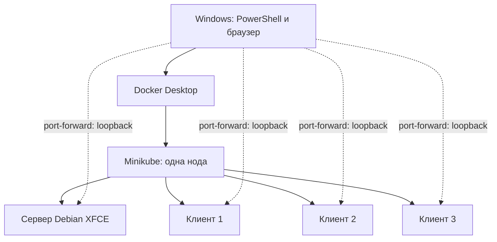

# Debian Network Lab

[](https://github.com/melekhovv/debian-lab-k8s/actions/workflows/validate.yml)

**Linux networking · Kubernetes · PowerShell · Container state recovery**

[English](README.en.md)

[Демонстрация за 7 минут](docs/demo.md) · [Инженерные решения](docs/decisions.md) · [Доказательства](docs/evidence/README.md)

Домашняя лаборатория для изучения Linux, IP-маршрутизации и эксплуатации контейнерных сред. Windows и Docker Desktop служат платформой для Minikube; внутри Kubernetes разворачиваются сервер и три клиента Debian XFCE с рабочими столами в браузере.

Особенность проекта — маршрутизация между тремя учебными подсетями через сервер и собственный механизм сохранения состояния контейнеров. Проект демонстрирует реализацию в коде; результаты практических проверок отмечаются отдельно.

## Статус и границы подтверждения

Основа документации: статический аудит коммита `b8a8e257080ed0c731942157e16c15e69892f275`, выполненный 14 ноября 2026 года. Лаборатория при подготовке документации не запускалась.

**Проверено на стенде 14 ноября:** четыре Pod, сервисы, шесть направлений routing с входом/выходом пакетов на сервере, ответы трёх Zabbix agents и свежие метрики в БД. [Протокол и данные](docs/evidence/2026-11-14-runtime.md). Первоначальная недоступность Docker устранена запуском существующей среды. Независимый disaster recovery и alerting ещё не проверены.

| Область | Подтверждено исходниками | Ещё требуется проверить на стенде |
|---|---|---|
| Kubernetes | Четыре Pod запущены на зафиксированных версиях; манифесты и ресурсы в Git | Другие версии и нагрузка |
| Routing | Шесть направлений: ответы TCP, рост forwarding и вход/выход на сервере с TTL 63 → 62 | Отказы и защита от обхода при изменении сети |
| Linux services | Работающие MariaDB, Apache, Zabbix server/agent; frontend HTTP 200 | Воспроизводимая установка приложений из Git |
| Zabbix | agent.ping = 1 от трёх клиентов; свежие метрики в БД | Экспорт конфигурации, тест trigger и уведомления |
| Backup/recovery | Штатный restore отработал; четыре Windows-архива читаются, SHA-256 зафиксированы | Независимое восстановление Windows-копий и контроль БД |

Это учебная среда, а не production-кластер. Рабочие столы — контейнеры с общим ядром ноды, не отдельные VM. Наличие реализации не означает коммерческий опыт или выполненную эксплуатационную задачу.

## Какие навыки можно показать

- Linux networking: IPv4, маршруты, forwarding, proxy ARP, policy routing и диагностика conntrack.
- Kubernetes: Deployment, Service, namespace, ресурсы и диагностика Pod.
- PowerShell: общая конфигурация, обнаружение инструментов, сопровождение port-forward.
- Linux services: управление установленными сервисами и сохранение имени хоста.
- Сохранение состояния: overlayfs, rsync, архивирование и ограничения восстановления.

Кейсы: [routing](docs/cases/routing.md), [Linux services](docs/cases/linux-services.md), [Zabbix monitoring](docs/cases/zabbix-monitoring.md), [backup/recovery](docs/cases/backup-recovery.md). Стендовые результаты приложены в [протоколе](docs/evidence/2026-11-14-runtime.md); ограничения каждого кейса отмечены отдельно.

## Архитектура



Стрелки от Minikube обозначают размещение, а не маршрут учебного трафика. Подробнее: [архитектура](docs/architecture.md), [network topology](docs/network-topology.md).

| Среда | GUI по умолчанию | Дополнительные учебные адреса |
|---|---|---|
| Сервер | http://localhost:3000 | 192.168.2.254, 192.168.3.254, 192.168.4.254 |
| Клиент 1 | http://localhost:3001 | 192.168.2.1/24 |
| Клиент 2 | http://localhost:3002 | 192.168.3.1/24 |
| Клиент 3 | http://localhost:3003 | 192.168.4.1/24 |

http://localhost:3000/zabbix требует отдельно установленных и настроенных Zabbix frontend, Apache и БД. Текущие скрипты эти пакеты не устанавливают.

## Быстрый старт

Нужны Windows, PowerShell, Docker Desktop с Linux containers, `minikube` и `kubectl`. Значения для новой ноды: 4 CPU и 6144 MB; Docker Desktop и Windows требуют дополнительной памяти. Версии проверенной сессии опубликованы в [протоколе](docs/evidence/2026-11-14-runtime.md); нагрузочное потребление не измерялось.

Используйте выделенную лабораторную среду: скрипт меняет маршрутизацию и firewall ноды и обращается к Docker-контейнеру `minikube`. Перед запуском прочитайте [installation](docs/installation.md) и [security considerations](docs/security-considerations.md).

```powershell
.\start-debian.ps1 -NoBrowser
```

Либо откройте `start-debian.bat`. `lab.config.ps1` создаётся из [шаблона](lab.config.example.ps1); существующие настройки нужно сохранить. Окно запуска держите открытым для port-forward. Манифесты применяются при каждом старте: изменение шаблона Pod может пересоздать контейнер и уничтожить несохранённое состояние.

## Сохранение и остановка

В текущих манифестах нет постоянных томов. Несохранённые изменения writable layer могут быть потеряны при пересоздании контейнера.

```powershell
.\save-state.ps1
.\stop-debian.ps1
```

`stop-debian` также предлагает сохранение, затем stop или pause. Сохранение временно останавливает обнаруженные сервисы БД. Проверьте итог и Windows-архивы; сообщения скрипта не заменяют проверку восстановления. Подробности: [backup/recovery](docs/cases/backup-recovery.md).

## Безопасность

Рабочие столы рассчитаны на локальную среду без настроенной аутентификации; сервер имеет `privileged: true`, клиенты — `NET_ADMIN`. Оставляйте `$BindAddress = "127.0.0.1"`. Привилегированный сервер способен повлиять на ноду Minikube. ClusterIP не защищает от доступа изнутри кластера. Архивы могут содержать пароли, ключи и БД; они исключены из Git.

## Структура и документация

| Путь | Назначение |
|---|---|
| `start-debian.*`, `save-state.*`, `stop-debian.*` | Запуск, сохранение, остановка |
| `lab-common.ps1`, `lab.config.example.ps1` | Общие функции, адресация и шаблон настроек |
| `k8s/` | Текущие манифесты |
| `legacy/` | Историческая реализация Docker/VNC и Hyper-V, вне основного запуска |
| `docs/` | Архитектура, эксплуатация, кейсы и реестр доказательств |

- [Установка и настройки](docs/installation.md)
- [Диагностика](docs/troubleshooting.md)
- [Ограничения безопасности](docs/security-considerations.md)
- [Доказательства и критерии приёмки](docs/evidence/README.md)
- [Аудит и план дальнейших изменений](docs/audit-and-roadmap.md)

## Автоматическая проверка

GitHub Actions проверяет контракты текущих манифестов, ссылки и синтаксис PowerShell, не исполняя лабораторные скрипты. Шесть regression-тестов проверяют валидную конфигурацию и обнаружение ошибочных selectors, targetPort, незакреплённого образа, внешней публикации и отсутствующих limits. Это offline-проверки, не тест доступности приложений. Команды для локального запуска и сборщик наблюдений: [демонстрация](docs/demo.md).

Следующий шаг — независимая проверка восстановления на тестовой копии и контролируемая проверка alerting. Обновление образа, изменение сети, привилегий или хранения и испытание восстановления требуют отдельного согласования и плана возврата.
