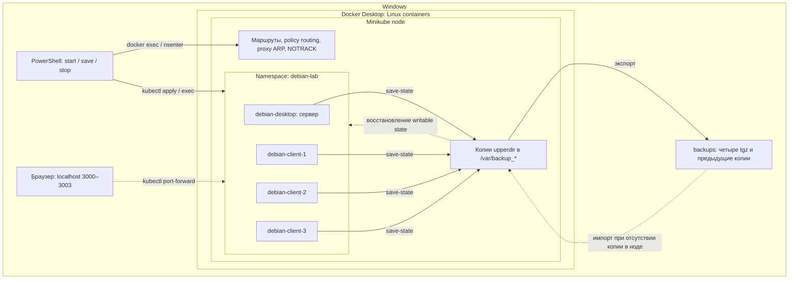

# Архитектура

[README](../README.md) · [Сетевая топология](network-topology.md)

Статус: подтверждено исходниками базового коммита `b8a8e25`; runtime не проверен. Текущая схема — одна нода Minikube с Docker driver. Namespace `debian-lab` содержит четыре Deployment с одной репликой каждый и четыре ClusterIP Service.

Схема показывает компоненты и операции скриптов, а не отдельные физические машины. Сервер и клиенты используют одинаковый digest webtop Debian XFCE. У сервера `privileged: true`, у клиентов добавлена capability `NET_ADMIN`. Текущие манифесты не подключают PVC или другие volumes; сохранение опирается на writable layer, исключая ряд runtime-путей.

## Поток запуска

1. `lab-common.ps1` загружает локальную конфигурацию, определяет инструменты, адреса и список сред.
2. `start-debian.ps1` проверяет Docker Desktop и запускает/возобновляет Minikube при необходимости.
3. Применяет два текущих YAML и ждёт rollout Deployment. Probes приложений отсутствуют: готовность Deployment не доказывает готовность Zabbix или БД.
4. Через `crictl`, `ctr` и `/proc/<pid>/root` находит контейнеры и восстанавливает состояние при отсутствии маркера `/run/lab-restored`.
5. Настраивает сеть, hostname-обёртки, заголовки webtop и nginx proxy `/zabbix` → Apache `127.0.0.1:80/zabbix` внутри сервера.
6. Запускает только уже установленные сервисы из конфигурации, проверяет один сетевой путь и запускает port-forward.

Port-forward управляется процессом PowerShell на Windows. Закрытие окна прекращает сопровождение пробросов; это не команда остановки Pod. Повторный запуск после пересоздания Pod нужен для настройки сети; он также повторяет остальные операции запуска и не является read-only диагностикой.

## Ресурсы

| Среда | CPU request / limit | RAM request / limit |
|---|---|---|
| Сервер | 500m / 2000m | 1Gi / 3Gi |
| Каждый клиент | 250m / 2000m | 512Mi / 1536Mi |
| Итого для четырёх сред | 1250m / 8000m | 2.5Gi / 7.5Gi |

Нода по умолчанию создаётся с 4 CPU и 6144 MB RAM. Суммарные limits выше её ресурсов; одновременное использование лимитов не обеспечено. Это статические значения, не измерения реального потребления.

## Зависимости и ограничения

- Скрипты напрямую обращаются к Docker-контейнеру `minikube`; произвольный профиль, multi-node и иной runtime не подтверждены.
- Нужны внутренние утилиты ноды: `crictl`, `ctr` с overlayfs, `nsenter`, `ip`, `iptables`, `rsync`, `python3`, `tar` с xattrs. Наличие и версии нужно зафиксировать на стенде.
- Webtop-патчи зависят от путей и содержимого файлов образа; перенос на другой digest требует проверки.
- CNI в прежнем README назван kindnet, но скрипт не закрепляет его при создании кластера. Фактический CNI требует проверки.
- `legacy/` содержит отдельную историческую реализацию с Dockerfile, Compose, VNC/noVNC, PVC и NodePort/Ingress; эти возможности нельзя приписывать текущему запуску.

Источники: [сервер](../k8s/debian-webtop.yaml), [клиенты](../k8s/debian-clients.yaml), [запуск](../start-debian.ps1), [общие функции](../lab-common.ps1), [сохранение](../save-state.ps1).
