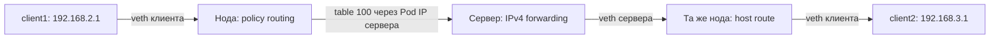

# Network topology

Обновление: [проверка работающего стенда 14 ноября 2026 года](evidence/2026-11-14-runtime.md) содержит фактические версии, routing, services и метрики; исходный аудит и дальнейшие критерии ниже сохранены с их границами.

[README](../README.md) · [Кейс routing](cases/routing.md)

Статус: алгоритм подтверждён исходниками; адреса и прохождение трафика на работающем стенде не проверялись.

## Адресация

| Участник | Учебный IP на eth0 | Маршруты в другие учебные сети |
|---|---|---|
| Сервер | 192.168.2.254/24, 192.168.3.254/24, 192.168.4.254/24 | Подключённые /24; forwarding включён |
| Клиент 1 | 192.168.2.1/24 | 192.168.3.0/24 и 192.168.4.0/24 через 192.168.2.254 |
| Клиент 2 | 192.168.3.1/24 | 192.168.2.0/24 и 192.168.4.0/24 через 192.168.3.254 |
| Клиент 3 | 192.168.4.1/24 | 192.168.2.0/24 и 192.168.3.0/24 через 192.168.4.254 |

Это дополнительные адреса на существующем `eth0`, рядом с CNI Pod IP. `.254` — next hop для других учебных /24, не замена default route. Три /24 не означают три VLAN, отдельных bridge или физическую изоляцию.

## Ожидаемый путь client1 → client2

Нода изображена дважды для двух проходов пакета; физически это одна нода.

## Как скрипт задаёт путь

1. Через `nsenter` находит `eth0` и veth peer каждого контейнера.
2. Добавляет учебные IP в network namespaces и host routes к этим IP на ноде; включает proxy ARP.
3. На сервере включает `net.ipv4.ip_forward=1` и отключает redirects.
4. На клиентах задаёт маршруты в другие учебные /24 через соответствующий `.254`.
5. На ноде добавляет правила `pref 1000`, привязанные к входному veth клиента и назначению в учебных /24. Таблица `100` направляет их на CNI Pod IP сервера.
6. Отключает `rp_filter` для `all` и veth сервера. Цепочка `LAB-NOTRACK` в raw PREROUTING исключает трафик между учебными /24 из conntrack. Комментарий кода связывает это с двойным прохождением ноды и фильтрацией INVALID в kube-proxy; фактический эффект нужно подтвердить.

Повторный запуск заменяет адреса/маршруты, очищает `LAB-NOTRACK` и удаляет **все** `ip rule` с приоритетом `1000`, затем создаёт свои. Это не полная гарантия идемпотентности или отсутствия влияния на чужие правила.

## Ограничения

- Нет контроллера, автоматически восстанавливающего сеть после смены Pod/veth. Предусмотрен повторный запуск основного скрипта.
- Серверный CNI IP выбирается с исключением всех `192.168.*`; CNI в таком диапазоне может нарушить настройку.
- Таблица `100` и приоритет `1000` могут конфликтовать с другими задачами ноды. Выделенный стенд обязателен.
- Не публиковать этот стенд как проверенный firewall или изолированную корпоративную сеть: NetworkPolicy и отдельные L2-сегменты в текущих манифестах отсутствуют.
- Встроенный тест выполняет TCP connect client1 → client2:9; ConnectionRefused считается ответом. Он сопоставляет это с ростом общего `ForwDatagrams` сервера минимум на 2. Фоновый трафик может повлиять на счётчик.
- GUI идёт через Kubernetes Service/port-forward и не проверяет учебную маршрутизацию.

Источник: [сетевой блок и self-test](../start-debian.ps1), [LabSubnets](../lab-common.ps1). План проверки: [routing](cases/routing.md).
